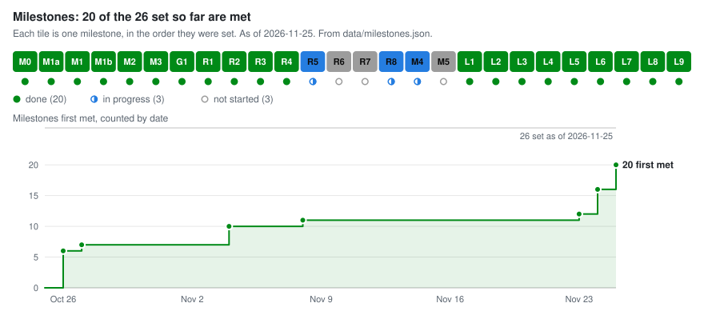
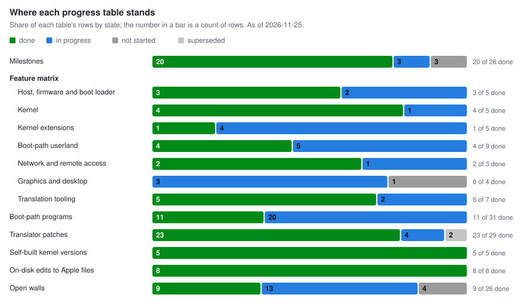

# Running macOS 27 on x86 hardware

A progress record for a hobby research project: getting macOS 27, which Apple ships
for Apple silicon only, to boot and run on an ordinary x86-64 PC as a virtual machine
guest.

This repository holds the **progress tables and the notes that explain them**, not the
work itself. There is no build or translation tooling, no disk image and no Apple code
here. Disk images and Apple code never will be: the images are built from Apple's own
files, and those files are Apple's. There are no how-to guides today either;
dated, best-effort guides are planned later. The only code here is [`scripts/render.py`](scripts/render.py)
and [`scripts/charts.py`](scripts/charts.py), which render the tables and charts. What is here is a record of what has been tried, what was
measured, and what is still broken, kept in machine-readable form under [`data/`](data)
and rendered into the tables and charts on the pages listed below.

<!-- generated:chart-milestones:start -->
<picture>
  <source media="(prefers-color-scheme: dark)" srcset="docs/charts/milestones-dark.svg">
  
</picture>
<!-- generated:chart-milestones:end -->

## What is being attempted

macOS 27.0.1 is an Apple-silicon release. Its installer and its boot path are built for
arm64e. But Apple has not finished removing x86-64 from the operating system: most of
the frameworks still carry an x86-64 slice, and 27.0.1's Kernel Debug Kit still ships an
x86-64 kernel. What is missing is the boot path. The project closes that gap three ways:

1. **Apple's own x86-64 code**, where 27.0.1 still ships it.
2. **Recompiling** Apple's arm64e build to x86-64, function by function, and linking it
   against 27's own x86-64 libraries. The project calls this *lifting*.
3. **Translation**: running Apple's arm64e program as itself, through an exec route added
   to a self-built kernel, with an open-source user-space translator as the engine.

Where a piece has none of the three yet, a part from macOS 26 (Tahoe) stands in, or a
small script does, and that is recorded as *in progress* rather than done. The full
account, with how many boot-path programs ship without an x86-64 slice:
[docs/approach.md](docs/approach.md).

## Where it stands

<!-- generated:readme-milestones:start -->
**20 of the 26 milestones** set so far are met.

The most recent, first met on 2026-11-25:

- **L6**: A menu bar and a wallpaper drawn after the login
- **L7**: A click reaches a control
- **L8**: A Finder window drawn after the login
- **L9**: An app opens a window and takes typed text

Not met yet:

- **R5**: 27's own amfid, logd, logd_helper and sandboxd in place of macOS 26's
- **R6**: Fold the furthest configuration into one disk image
- **R7**: launchd's own sshd reachable from the host
- **R8**: No macOS 26 piece left in the boot
- **M4**: A desktop on 27's own programs
- **M5**: Graphics acceleration

Pass conditions and dates: [docs/milestones.md](docs/milestones.md).

<sub>Generated from `data/milestones.json` by `scripts/render.py`. Data and generated tables: [CC0-1.0](LICENSE-CC0) (public domain).</sub>
<!-- generated:readme-milestones:end -->

The work runs in two stages ([docs/roadmap.md](docs/roadmap.md)): first something that
works, built on whatever works today, including x86 code of Apple's that the project
means to stop depending on later; then the longer tail of replacing it.

**The current figures are on [docs/progress.md](docs/progress.md)**: each step of the
first stage with its date and the number of boots behind it, what has been measured, and
what is not shown yet. That page and the charts take each routine update; this page
changes only at a major milestone.

<!-- generated:chart-status-overview:start -->
<picture>
  <source media="(prefers-color-scheme: dark)" srcset="docs/charts/status-overview-dark.svg">
  
</picture>
<!-- generated:chart-status-overview:end -->

Two further limits worth stating plainly, because no single row carries them:

- **Nothing here is a usable macOS install.** There is no usable desktop on the 27-only root,
  no graphics acceleration, and the parts that work do so in a lab configuration
  assembled by hand for each boot. Nobody should read this as a route to running macOS 27
  on their own PC.
- **"Runs" mostly means "was running".** For most programs the measurement is that the
  process existed and did not die. Whether it actually did its job was measured for only
  a handful of them, and the tables say which.

## The pages

The sections that earlier versions of this page carried (where it stands step by step,
status at a glance, what has been measured, what is not shown yet, the detail tables, how
to read the tables, and the data files) are on these pages now.

| Page | What it holds | Changes |
|---|---|---|
| <a id="status-at-a-glance"></a><a id="what-has-been-measured"></a><a id="what-is-not-shown-yet"></a><a id="detail"></a>[docs/progress.md](docs/progress.md) | Where it stands, step by step; status at a glance; what has been measured; what is not shown yet | each snapshot |
| [docs/milestones.md](docs/milestones.md) | Milestones, with the pass condition each one had to meet | each snapshot |
| [docs/components.md](docs/components.md) | The feature matrix: every layer, and what runs there today | each snapshot |
| [docs/boot-programs.md](docs/boot-programs.md) | Boot-path programs (a few rows group several), with what is and is not known | each snapshot |
| [docs/launchd-labels.md](docs/launchd-labels.md) | The `launchd` job labels on the furthest booted root whose program paths are on 27.0.1's system volume or its Data-volume template | when a new inventory is taken |
| [docs/kexts.md](docs/kexts.md) | Every entry of the kernel collection that root booted with | when a new inventory is taken |
| [docs/translator-patches.md](docs/translator-patches.md) | Translator patches, kernel versions, and the on-disk edits to Apple files | each snapshot |
| [docs/gaps.md](docs/gaps.md) | Open walls, and the record of risks that were accepted rather than fixed | each snapshot |
| [docs/roadmap.md](docs/roadmap.md) | The two stages, what done means for the first, and the dependence on Apple's x86-64 libraries | each snapshot |
| [UPSTREAMS.md](UPSTREAMS.md) | The projects this builds on and others close to it, with measured activity, and the open items with them | each snapshot |
| [docs/notes-for-liberator.md](docs/notes-for-liberator.md) | Two DriverKit findings written up for other projects booting macOS 27 on Intel | rarely |
| [docs/approach.md](docs/approach.md) | The three ways the project closes the gap, and how many `launchd` jobs run a program with no x86-64 slice | rarely |
| <a id="how-to-read-the-tables"></a>[docs/reading-guide.md](docs/reading-guide.md) | How to read the tables: the evidence labels, `n` and the state words | rarely |
| <a id="the-data-and-how-these-tables-are-made"></a>[docs/data.md](docs/data.md) | The data files, and how the tables and charts are made from them | rarely |
| [docs/maintaining.md](docs/maintaining.md) | What a routine update touches, and when this page changes | rarely |
| [CHANGELOG.md](CHANGELOG.md) | What changed in each snapshot | each snapshot |

Every table in a generated region, and every chart, is generated from `data/*.json` by
[`scripts/render.py`](scripts/render.py), and CI fails if any of them disagrees with the
data; the step table on the progress page and a few short tables are hand-written:
[docs/data.md](docs/data.md).

## Repository layout

```
data/         the numbers, as JSON. Every generated progress table, inventory and
              chart is rendered from these
docs/         one page per large table, with the notes that explain it, and the
              progress page that takes each routine update
docs/charts/  the charts, one SVG per chart for GitHub's light theme and one for
              its dark theme
scripts/      render.py and charts.py, which build the tables and charts
```

## Licences

Stated per directory and file, because the three kinds of content here are not under the same
terms:

| Directory | Content | Licence |
|---|---|---|
| `scripts/`, `.github/workflows/check.yml` | code | **MIT OR Apache-2.0** ([MIT](LICENSE-MIT), [Apache-2.0](LICENSE-APACHE)) |
| `README.md`, `CHANGELOG.md`, `CONTRIBUTING.md`, `docs/` (apart from `docs/charts/`) | prose and write-ups | **MIT OR Apache-2.0 OR CC-BY-4.0** ([CC-BY-4.0](LICENSE-CC-BY-4.0)) |
| `data/`, every generated table, and the charts in `docs/charts/` | data, generated tables and charts | **CC0-1.0** ([CC0-1.0](LICENSE-CC0)), public domain |
| `CITATION.cff` | citation metadata | **CC0-1.0** |

`OR` is as in [SPDX](https://spdx.dev/): you may take whichever of the listed licences
you prefer. The data is CC0 so that the measurements can be quoted, checked and
re-used with no attribution requirement at all; every generated table carries that
notice beneath it.

No Apple code, and no file from macOS, is in this repository. The tables name Apple's
programs, their paths and its kernel-extension identifiers in order to describe them;
none of the licences above covers anything of Apple's.

## What this project does and does not do

This is a non-commercial research record. It documents an attempt to understand how
macOS boots, and whether it can be made to run as a guest on x86 hardware the author
owns. It is not affiliated with, sponsored by or endorsed by Apple Inc.

We keep to these rules:

- This repository contains no Apple software: no binaries, disk images, installers,
  firmware, kernel caches, keys, or disassembled or decompiled Apple code. It describes
  what was changed and measured, not the bytes.
- Anyone working in this area must use their own copy of macOS, obtained from Apple, and
  is responsible for the terms under which they obtained it. Apple's licence for macOS
  limits it to Apple-branded hardware; read it before you do anything.
- The repository contains no tool or instructions for circumventing any technical
  protection measure.
- The images are built and the guests are run privately, on the author's own hardware. No
  macOS image or running guest is sold, hosted or offered as a service, and the project
  takes no payment.
- Apple, Mac and macOS are trademarks of Apple Inc., used here only to say what the
  research concerns.

Courts have recognised that research uses of an operating system can be fair use: in
*Apple Inc. v. Corellium, Inc.* (S.D. Fla. 2020; 11th Cir. 2023, unpublished,
non-precedential), copying iOS into a security-research tool that added its own features
was held to be fair use. That case did not decide whether the product violated the
anti-circumvention rules (that claim settled), although the trial court held that fair
use is no defence to them; it decided no claim under Apple's licence, and concerned
security research rather than this project's goal. We cite it to explain why research of
this kind is worth recording, not as a claim that this work is lawful.

This is not legal advice. If you have concerns about your own situation, consult a
lawyer.

## Contributing

Corrections to the measurements are the most useful thing anyone can send. See
[CONTRIBUTING.md](CONTRIBUTING.md) for how the data files are shaped and why a
correction has to edit `data/` rather than the rendered table.

## Citing

See [CITATION.cff](CITATION.cff). Please cite the date and the snapshot's internal
revision along with it, since the figures move.
