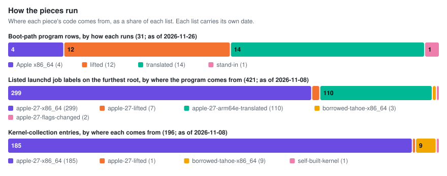

# Boot-path programs

[&larr; back to the README](../README.md)

The programs that have to work before anything else can. For each one: how Apple ships
it in macOS 27.0.1, how it is being run here, and what is actually known about it.

The second column is the reason the project exists. Where it says **arm64e only**, Apple
ships no x86-64 build of that program in 27.0.1, so it has to be recompiled, translated,
borrowed from macOS 26, or stood in for. Where it says **x86_64**, Apple's own build runs
unchanged and the row is there only to record that it was seen working.

<!-- generated:chart-how-pieces-run:start -->
<picture>
  <source media="(prefers-color-scheme: dark)" srcset="charts/how-pieces-run-dark.svg">
  
</picture>
<!-- generated:chart-how-pieces-run:end -->

<!-- generated:boot-programs-table:start -->
| Program | How Apple ships it in 27.0.1 | How it runs here | State | Evidence | n | Notes |
|---|---|---|---|---|---|---|
| launchd (pid 1) | arm64e only | lifted | done | measured | 3 | All 1,468 functions lifted, 1,403 pass the differential test, 0 fail. In one boot the kernel's code-directory hash for pid 1 equals the lift's, proving which launchd ran. Since 2026-11-24 the project's default test bases, each one standalone disk image, carry both (2 test boots each). Stopping a service no longer panics the guest: 0 panics in 2 boots with the fix, against 1 in a control boot without it. |
| xpcproxy | arm64e only | lifted | done | measured | 2 | 100 of 100 functions lifted, 99 pass. 0 environment errors in 1,020 job spawns; macOS 26's xpcproxy fails beside 27's launchd. Relinked with the newer link tools, it binds lazily loaded libraries as dyld does. Before, every spawn of the two launchd jobs that name a cryptex (accountsd and spindump) ended with the old build stopping at a lazy-load helper, 428 times in one boot; with the relinked build both ran in each of the 9 boots that reached a login with it, and it is in the default test bases. |
| amfid | arm64e only | translated | in progress | measured | 4 (27's); macOS 26's: 2 boots read on the login overlays, 1 on the default base | Stays up, exit status 0, in 4 boots, where macOS 26's amfid crashes in every boot. In one boot it refused an ad hoc signed program carrying a restricted entitlement, with Apple's error for that case; an edited-signature test did not discriminate. On the login test overlays the amfid in place is still macOS 26's x86_64 build (a file of the size of Apple's 27 build is kept there, set aside): it wrote 7 and 9 crash reports in the 2 boots read, each after calling a method that macOS 27's code-signing framework has renamed, and the kernel logged code-directory checks with no server to answer them (11 times in 1 boot). The default test base adopted on 2026-11-25 carries the same macOS 26 build: the 6 amfid crash reports of a login boot on it name it (why each crashed was not read there). Putting Apple's 27 amfid back, run translated on a build carrying patch S, is the chosen fix; it has not been booted on the login line. |
| logd | arm64e only | translated | in progress | measured | 3 | 27's own logd runs translated as the logd job on the furthest configuration, exit status 0 in 3 of 3 boots; in one, the kernel's code-directory hash for it equals Apple's arm64e build. 27's log command reading its messages back was measured on other configurations (2 of 2), not yet on this one. |
| logd_helper | arm64e only | translated | in progress | measured | 3 | 27's own logd_helper runs translated on the furthest configuration, exit status 0 in 3 of 3 boots; in one, the kernel's code-directory hash for it equals Apple's arm64e build. Doing its job is not measured. |
| sandboxd | arm64e only | translated | in progress | measured | 2; on the login overlays 2 read; 1 login boot on the default base (no crash report; service not checked) | Died at boot when launchd started it, before patch X. With X, a hand-started copy got past the failure in 2 of 2 boots; in the second, the launchd-started copy was still restarting, though that copy ran with a trace option the hand-started one did not, so the two are not a controlled comparison. That fix (patch X) had an open race and has been replaced by patch Y, whose boots are not written up in this record yet. On the login test overlays it runs on an older translator build that lacks patch U, so when its own sandbox profile refuses run-time code the translator stops it at once (17 crash reports in each of the 2 boots read). Naming it for a build that carries U and Y is the chosen fix; it has not been booted on that line. In the one login boot on the default test base adopted on 2026-11-25, whose default translator build carries both, no sandboxd crash report was written (which build it ran on there, and whether it served, were not read). |
| taskgated | arm64e only | translated | in progress | measured | 1 | Not started in the boot measured (on demand). |
| kernelmanagerd | arm64e only | translated | in progress | measured | 1 | Starts and checks in. The 240-second registry stall it reported is explained (docs/gaps.md, B18): with either measured fix, 0 stall lines in every test boot counted. The project's default test bases since 2026-11-24 carry one of the fixes. |
| kmutil and kextload | arm64e only | translated | in progress | measured | 1 | Run to rc 0 in the guest, but rc 0 was not a load: a kext was not loaded afterwards. Collections are still built by macOS 26's kmutil. |
| sshd | arm64e only | translated | in progress | measured | 9 | Started in debug mode by a test payload, not by launchd. With a 180 s login timeout, 3 of 3 logins in 8 of 9 boots and 1 of 3 in one; with a 60 s timeout, none (docs/components.md). |
| diskarbitrationd | arm64e only | lifted | in progress | measured | several boots; 1 serving; Apple's build in its place: 7 login boots | 603 functions pass, 0 fail. Relinked with the newer link tools, on a root with the registry stall fixed, it ran the whole boot and both disk rounds (a scratch disk and a RAM disk) passed through it (1 boot). Earlier, in one image, its clients got no answer from it, lifted or translated. Apple's own arm64e build under translation served the scratch-disk round in 7 of 8 boots counted with the registry quiet. On the login test overlays since 2026-11-24, Apple's own arm64e build runs translated in its place, with the system's memory-limit settings changed to give it a higher limit: with the recompiled one, storagekitd (a disk-management service 27.0.1 ships for x86-64) crashed in the 4 boots of that line with no login window, and in the crash reports read its first request to the daemon was still unanswered; with Apple's build it kept one process and the window appeared (all 7 scored boots, the last on the default test base, which carries the same build; one more was stopped by the test harness before it could show either way, and another, stopped by the tester part way through after its login, is not counted). Why the recompiled one answers in time in some boots and not in others is not read. |
| powerexperienced | arm64e only | lifted | done | measured | several boots | 726 functions pass, 0 fail. Runs for the whole boot. Under translation it needed the translator to count its own memory against the process limit. |
| dirhelper | arm64e only | lifted | done | measured | several boots; 2 for the folder | 38 of 38 functions pass. Serves for the whole boot. It creates the root of the system's per-user temporary folders itself, so the copy the project used to pre-create on the image is retired (2 of 2 boots). |
| fsck | arm64e only | lifted | done | measured | several boots | Boot task. The real work is in 27's x86_64 fsck_apfs, which it calls. |
| dirs_cleaner | arm64e only | lifted | done | measured | several boots | Boot task. An early kernel panic at its exit was traced to the borrowed macOS 26 Sandbox kext, not to this program; the recompiled 27 Sandbox kext does not have it. |
| cc_fips_test | arm64e only | lifted | done | measured | several boots | Boot task. Calls 27's x86_64 corecrypto. |
| seputil (prngseedd) | arm64e only | lifted | done | measured | several boots | Boot task (data protection), run to success. The prngseedd job label, which uses the same program, did not start in the boot counted in docs/launchd-labels.md. |
| xpcroleaccountd | arm64e only | lifted | in progress | measured | several boots | Placed; launchd runs it as a boot task, but whether the task succeeds has not been read. Its job label did not start in the boot counted in docs/launchd-labels.md. |
| rootless-init, prng_seedctl, init_exclavekit, ifcstart, launchctl | arm64e only | lifted | done | measured | several boots | Boot tasks and tools; run to success. |
| KernelEventAgent | arm64e only | lifted | in progress | measured | 1 | Exited with status 74 about every 10 s, at an indirect call into a lazy-load helper section the link tools did not translate. Relinked with the newer link tools, it ran once for the whole boot with 0 such exits (1 boot). What it does is not read. |
| mount (for the Preboot volume) | arm64e only | stand-in | in progress | measured | several boots | A 945-byte shell script that runs 27's own x86_64 apfs_boot_util. Lifting 27's mount would retire it. |
| tccd | x86_64 | Apple x86_64 | done | measured | 2 | Crashed about 11 times per boot until the recompiled Sandbox kext answered a storage-class check; 0 crashes since. |
| configd, notifyd, syslogd, mDNSResponder, securityd, cfprefsd, opendirectoryd, trustd, powerd | x86_64 | Apple x86_64 | done | measured | many boots | Running. Doing their job is measured only for configd (a DHCP address) and the shells. |
| WindowServer launcher | arm64e only | translated | in progress | measured | several boots | Starts under translation on the 27-only root. In one boot it never opened the framebuffer; with the two display byte edits placed in the root's cache, it stays up and shows the boot progress window, and then the login window, which appears or not, most likely depending on whether the guest's display goes to sleep first (inferred) (docs/gaps.md, B21). The graphics stack it starts (SkyLight) does ship x86_64. |
| loginwindow | arm64e only | translated | in progress | measured | 14 boots to a typed login; 1 boot recompiled | Under translation on test overlays of the 27-only root it draws the login window and takes a typed login, the user session starts (12 boots) and it hands over to User Account Updater, which completed in 9 boots. In the 2 boots in which the first-login Setup Assistant then ran, no window of it appeared; with a per-user marker the test places, Setup Assistant is skipped and the Dock, Finder, SystemUIServer and Control Center start (7 boots; docs/gaps.md, B22). A recompiled build, signed as a bundle with the lab key, launches and exits with status 70 every time (1 boot: 236 starts, 236 exits, no crash report); the cause is not read. |
| Dock, Finder, SystemUIServer, ControlCenter | arm64e only | translated | in progress | measured | 7 | In the 2 boots in which the first-login Setup Assistant ran, Dock, Finder and SystemUIServer never started; ControlCenter did. With a per-user marker, placed by the test, that skips Setup Assistant, all four started after the login (about 1 to 6 minutes after it, where read) and were still running, once each, at the last reading of the boot (7 boots). The Dock was first seen drawn between about 10 and 35 minutes after the login in 5 of them, and was not drawn in the other 2; in the later of those it was running and every thread sampled was waiting in the translator. With WindowManager staying up (patch AB), a click on the Dock's Finder icon opened a Finder window (2 boots; in a third boot, with no Dock drawn, a key command did), and Control Center opened from the menu bar, partly drawn (1 boot). Whether these programs do their whole job has not been tested. |
| Setup Assistant (first login) | arm64e only | translated | in progress | measured | 2 boots in which it ran; skipped in 7 | It is launched for a new user's first login, after User Account Updater (in the first boot loginwindow logged its transition to it), even when its record for the user was marked complete beforehand (1 boot; the updater logged a new user account). In the first boot it became the frontmost app, but no pane of it appeared; the screen stayed black to the end of the boot, and the disk ran out of space about a minute after it was launched. The second ended with the same black frame, and the disk did not run out (docs/gaps.md, B22 and B23). Why no pane appears is not read; that it is Setup Assistant's own fault rather than drawing or compositing is not shown. Since 2026-11-24 a per-user marker the test places before the login skips it: the updater logs the marker as set and Setup Assistant is not launched (4 boots; in 3 later boots its main process again did not run). That is a test arrangement, not a fix. |
| WindowManager | arm64e only | translated | in progress | measured | 7 | Crashed soon after each start and was restarted, until patch AB (docs/gaps.md, B25). In the first login boots that ran it, it exited with status 134 again and again, the reason not read. In the next, with its error output captured, every crash followed the translator's refused reads of the program's own memory (1,001 refused-read warnings across 125 processes); patch Z removed those (0 in the next boot). Then it died at a disconnect Apple's libraries treat as impossible: in one boot 9 times, after which it stayed up from its tenth start; in the next it did not settle (its run count reached 297). In that last boot the disconnect is read to follow from WindowManager's own sandbox profile refusing the translator's event-queue calls (each step read in code or a log, the chain not watched live). With patch AB (docs/translator-patches.md) it stays up: one instance all boot and no crash report in 3 boots, and the collected sandbox lines (with a few short gaps) showed no refused system call for it (the first boot with its tracing on, the other two without). Whether it does its whole job has not been tested. |
| MenuBarAgent, NotificationCenter, AirPlayUIAgent, WallpaperAgent, contactsdonationagent | arm64e only | translated | in progress | measured | 5 | The session's app-sandboxed agents. In the boot before patch AA, the first four stopped before their main function, refused a second sandbox profile (239 crash reports); MenuBarAgent's launches after the login failed earlier still, in the launcher, at a step of the test's own logging set-up (inferred); and the fifth exited with the same status in each of its 47 runs, at a point not read (docs/gaps.md, B24). With AA, each process asked for its sandbox once, under its own name, and none stopped there; four stayed up to the end of the boot, and WallpaperAgent was killed twice by the system for holding too many assertions and restarted (inferred to follow from WindowManager's restarts, B25). With Setup Assistant skipped by the test's marker, a menu bar and a wallpaper were drawn in that boot (1 boot). In the 3 login boots since, each process of the five again asked once, all five were running at the end, and WallpaperAgent was not killed for holding too many assertions. |
| accountsd, ScreenTimeAgent | x86_64 | Apple x86_64 | in progress | measured | 2 | User Account Updater waits on ScreenTimeAgent, which waits on accountsd at its own start-up. accountsd never started until xpcproxy was relinked; with it, accountsd started 78 s after the login and stayed up for the rest of the boot, ScreenTimeAgent checked in its service, and User Account Updater exited with success. A second boot read the same: accountsd still up 600 s after the login, and User Account Updater exited. Its Screen Time plug-in still logged a failed call to the agent to apply default user policies, so ScreenTimeAgent is not shown doing its job. |
| Apple HID driver extension (keyboard and tablet services) | x86_64 | Apple x86_64 | in progress | measured | 1 boot crashing read in full, 3 with the fix, and a static reading | Apple's HID driver extension (com.apple.AppleUserHIDDrivers) ships an x86_64 slice, which runs against 27's x86_64 DriverKit shared cache. It crashed at start with SIGBUS before any driver code ran, and was launched again and again (6 launches and 17 crash lines in one boot; 6 and 5 crash reports in two boots of later overlays). Cause, read statically from 27.0.1's own files: that cache's libdyld forwards calls to dyld one table slot short, so a call reaches the neighbouring function, which writes into a read-only code page. With the shifted forwarding stubs moved up one slot and the cache re-signed, it launched once and was not relaunched (2 boots read), no crash line named it (3 boots on two overlays), and both HID event services started (1 boot read in full). Pointer events were seen reaching the HID queue, and after a login clicks have opened controls (the Apple menu in 2 boots; milestone L7); keyboard input reaches the login window in the later login boots (docs/gaps.md, B21), and TextEdit after the login (2 boots). |

Generated from `data/boot-programs.json` by `scripts/render.py`. Data and generated tables: [CC0-1.0](../LICENSE-CC0) (public domain).
<!-- generated:boot-programs-table:end -->

## The two rows that carry the most weight

**`launchd` (pid 1)** is the one that makes the rest meaningful. It is Apple's own
arm64e `launchd` from 27.0.1, recompiled to x86-64: all 1,468 of its functions, 1,403 of
which pass a test that runs the recompiled function and Apple's original under emulation
from the same starting state and compares the results, with none failing and the
remainder giving no reading. In one boot the kernel's own code-directory hash for pid 1
matched the hash of the recompiled binary, which is what makes the claim "this launchd
ran" a measurement rather than an inference from a file having been placed on disk.

**`xpcproxy`** matters because it is how `launchd` starts everything else. macOS 26's
`xpcproxy` fails next to 27's `launchd`; the recompiled 27 one produced no environment
errors across 1,020 job spawns.

## What the states hide

Several rows say *in progress* for quite different reasons, and the distinction is worth
making explicit:

- **Runs but is not known to work.** `amfid` stays up for a whole boot, where macOS 26's
  crashes in every boot &mdash; but its signature checks are only partly tested. In one
  boot it refused an ad hoc signed program carrying a restricted entitlement, with
  Apple's error for that case (n = 1); a test with an edited signature did not
  discriminate. So nothing broader should be concluded about code-signing enforcement on
  this configuration. On the login test overlays and the default test base adopted on
  2026-11-25 the `amfid` in place is still macOS 26's,
  and it crashes there ([gaps.md](gaps.md), B11).
- **Runs and does not serve.** `diskarbitrationd` runs for the whole boot, and 603 of its
  functions pass the differential test, yet in one image its clients get no answer from
  it. That is true whether it is recompiled or translated, which points at something
  other than the recompile.
- **Exits with a status nobody has read yet.** `KernelEventAgent` exited with status 74
  in the one boot measured. The cause has not been looked at.
- **Succeeds without doing the thing.** `kmutil` and `kextload` run to exit status 0
  under translation, but no extension was loaded afterwards. Exit 0 here is not evidence
  of success, and collections are still built with macOS 26's `kmutil`.
- **Dies.** `sandboxd` died at boot when `launchd` started it, before patch X. That
  translator fix removed the failure for a hand-started copy in 2 of 2 boots; in the second of them the
  `launchd`-started copy kept restarting (it ran with a trace option the hand-started one
  did not). That fix (patch
  X) had an open race and has been replaced by patch Y, whose boots are not written up in
  this record yet. On the login test overlays it runs on a build without patch U and is
  stopped at once ([gaps.md](gaps.md), B17).

The last point in that list is the general caution for this whole page: for most of these
programs the measurement is that the process existed and kept running. Only a few
(`configd` getting a DHCP address, the shells, `dirhelper` serving, `tccd` stopping its
crashes) were measured doing their job.
