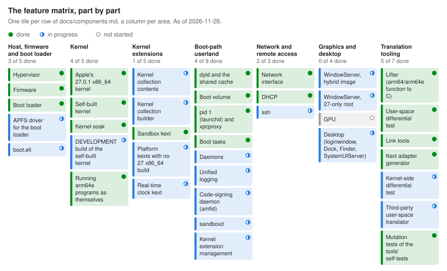

# The feature matrix

[&larr; back to the README](../README.md)

Every layer of a macOS 27 guest on x86, what is running there today, and how far it is
from the goal of a system built only out of macOS 27's own pieces.

Read the **What runs there today** column first. It is where the honesty of the page
lives: a row saying *done* against "macOS 26's apfs.efi" would be a lie, so that row says
*in progress*, and the state words are used that way throughout. A layer counts as *done*
only when 27's own piece is in place, or when nothing needs replacing at that layer at all
(the hypervisor, for instance, is stock QEMU and is expected to stay that way).

The `n` column says how many boots or test cases a row rests on; `measured` with
`n = 1` means exactly one boot of one configuration. See
[the reading guide](reading-guide.md) for the state and
evidence words.

<!-- generated:chart-feature-matrix:start -->
<picture>
  <source media="(prefers-color-scheme: dark)" srcset="charts/feature-matrix-dark.svg">
  
</picture>
<!-- generated:chart-feature-matrix:end -->

<!-- generated:components-table:start -->
<h2 id="host">Host, firmware and boot loader</h2>

3 done, 2 in progress, 0 not started.

| Part | What runs there today | State | Evidence | n | Notes |
|---|---|---|---|---|---|
| Hypervisor | Stock QEMU with KVM on Linux, unmodified | done | measured | every boot | Nothing to change in QEMU so far. |
| Firmware | OVMF (UEFI), as shipped by the OSX-KVM project | done | measured | every boot | &mdash; |
| Boot loader | OpenCore 1.0.x with the project's own configuration | done | measured | every boot | Its custom kernel-slide setting is needed: without it Apple's boot.efi sometimes picks a slide that lands in firmware-reserved memory (9 of 9 boots passed with it). |
| APFS driver for the boot loader | macOS 26's apfs.efi | in progress | measured | every 27-only boot | 27's APFS container carries no x86 EFI driver. |
| boot.efi | macOS 26's x86 boot.efi (27.0.1 ships no x86 boot loader), edited on disk so it creates two device-tree properties 27's userland expects from firmware | in progress | measured | 1 boot each way | Without them, kmutil and kextload abort about 11 s after start; with them they run. |

<h2 id="kernel">Kernel</h2>

4 done, 1 in progress, 0 not started.

| Part | What runs there today | State | Evidence | n | Notes |
|---|---|---|---|---|---|
| Apple's 27.0.1 x86_64 kernel | From Apple's Kernel Debug Kit, with seven early-boot patches and a set that maps the commpage into user processes | done | measured | many boots | Apple still ships an x86_64 kernel in 27.0.1's KDK, but on this guest it does not boot as shipped: several early-boot paths assume arm64 behaviour. |
| Self-built kernel | Built from Apple's published xnu source (xnu-12377.121.6, macOS 26.5) plus 27's missing interfaces, now at the project's version 1.5.4 | done | measured | 4 boots to loginwindow on the hybrid; 3 boots of the 27-only root at 1.5.4 | Not Apple's kernel: its version string is 25.5.0. It needs none of the load-time patches. Missing syscalls, MIG routines and exports were re-derived from 27's own x86_64 machine code; closed routines with no source were re-emitted from 27's machine code and checked instruction by instruction. Not matching Apple yet, found on 2026-11-25 (1 run each): a process running as an ordinary user set its own task's kernel port to null, and this kernel allowed it, with the guest's security settings (which allow unrestricted NVRAM and an unauthenticated root, but not a kernel debugger); afterwards the kernel's call that names the process's own task answered null. On an Apple silicon Mac running macOS 27.0.1, Apple's arm64 kernel, with System Integrity Protection on, refused the same call (KERN_NO_ACCESS); the two machines' security settings differ, so that comparison is not like for like. A reading of Apple's published xnu source, which this kernel is built from, allows the call only when the kernel-debugger setting is on, which the guest's settings leave off. Why this kernel allows it is not read. |
| Kernel soak | 66 minutes beside Apple's kernel on the same disk | done | measured | 1 | 0 panics either way, the same crash reports at the same rate. Not repeated on 1.5.x. |
| DEVELOPMENT build of the self-built kernel | Boots, then core daemons end themselves in a loop | in progress | measured | 2 boots | Both boots were on an earlier version of the kernel and have not been repeated on 1.5.x. In the first, 2,304 daemon exits in 26 minutes against 1 on RELEASE on the same host; in the second, a boot argument that allows the legacy message trap did not stop them. The RELEASE build compared did not show the loop; the cause is not found. |
| Running arm64e programs as themselves | A Rosetta-shaped exec option in the self-built kernel: the arm64e program is the process, and a static x86_64 runtime beside it runs a translator | done | measured | several boots | The kernel answers Apple's own identity, code-directory hash and entitlements for the translated program. Off unless a boot argument turns it on. |

<h2 id="kexts">Kernel extensions</h2>

1 done, 4 in progress, 0 not started.

| Part | What runs there today | State | Evidence | n | Notes |
|---|---|---|---|---|---|
| Kernel collection contents | 185 of 27's own x86_64 kexts, 9 borrowed from macOS 26, the recompiled Sandbox kext, and the kernel | in progress | measured | 1 | Full list: docs/kexts.md, for the collection the furthest earlier root booted with. A collection with one more entry, Apple's x86_64 IOUserSerial.kext from 27.0.1's Kernel Debug Kit, clears the registry stall (docs/gaps.md, B18): 4 test boots first, and it is in the project's default test bases since 2026-11-24 (2 test boots each). |
| Kernel collection builder | macOS 26's kmutil, run inside a recovery guest | in progress | measured | every build | 27's own kmutil runs under translation in the guest, but has not yet loaded a kext or built a collection there. |
| Sandbox kext | 27.0.1's own arm64e Sandbox.kext, the 958 reachable functions of its 967 recompiled to x86_64 and wrapped by a generated adapter | done | measured | 2 boots on Apple's kernel image; on the self-built kernel, 2 boots agreeing on every probe row plus 1 on a later version | Enforces read, write, exec, network and default-deny as native 27.0.1 does. The network-outbound probe rows are no reading, and a named-sysctl deny is consistent with enforcement but not closed. |
| Platform kexts with no 27 x86_64 build | ACPI platform set, APIC, EFI runtime and NVRAM, HPET, bus power controller: borrowed from macOS 26 | in progress | measured | 1 | The route that recompiled the Sandbox kext is the planned replacement. |
| Real-time clock kext | Borrowed from macOS 26 | in progress | measured | 1 | 27.0.1's KDK does have an x86_64 build, so this one is a swap, not a recompile. |

<h2 id="userland">Boot-path userland</h2>

4 done, 5 in progress, 0 not started.

| Part | What runs there today | State | Evidence | n | Notes |
|---|---|---|---|---|---|
| dyld and the shared cache | 27's own x86_64 dyld and x86_64 shared cache (the one Apple ships for Rosetta) | done | measured | many boots | The main cache is signed with 16 KiB hash pages, which the x86 kernel rejected, so it is re-signed at 4 KiB. The cache's own signature is ad hoc, so nothing is lost. |
| Boot volume | 27.0.1's own APFS system volume, in a real volume group with a Data volume seeded from 27's template | done | measured | many boots | Placed files were checked against the placement records, with ten deliberate damages all caught. |
| pid 1 (launchd) and xpcproxy | 27's own arm64e launchd and xpcproxy, recompiled to x86_64 | done | measured | launchd 3, xpcproxy 2 | Since 2026-11-24 the project's default test bases, each one standalone disk image, carry both (2 test boots each; the one adopted on 2026-11-25 is built from the first). Stopping a service no longer takes the guest down: an earlier build of the recompiled launchd exited when it stopped a service, and the kernel panicked (1 control boot). With the fix, 0 panics in 2 boots; in one of them launchd waited its 10 s exit timeout, then killed a service that ignored the stop request, and stayed pid 1 throughout. xpcproxy relinked with the newer link tools binds lazily loaded libraries as dyld does: before, the two launchd jobs that name a cryptex (accountsd and spindump) never started, 428 failed spawns in one boot; with it, both ran in each of the 9 boots that reached a login with it. Details per program: docs/boot-programs.md. |
| Boot tasks | 27's own arm64e boot tasks, recompiled to x86_64 | done | measured | many boots | The boot reaches the daemon phase with them in place. Success was read for some tasks only (docs/boot-programs.md says which); xpcroleaccountd's outcome is unread. |
| Daemons | On the furthest root, in the boot the note counts, by label: 299 labels (289 programs) of 27's own x86_64 programs, 110 labels (105 programs) of programs 27.0.1 ships without an x86_64 slice, under translation, 7 recompiled, 3 borrowed from macOS 26 (amfid, logd, logd_helper), and 2 whose file flags were changed. In three later boots 27's own replaced the three borrowed ones | in progress | measured | 1 | One boot of about 1,000 s: launchd's job table held 411 labels; 126 of them showed a process id or an exit status, 15 of those a nonzero one. Counting only labels whose program is on 27's system volume or, for five under /Library/Apple, in its Data-volume template, 118 of 388 ran (one of the five among them). docs/launchd-labels.md lists 421 such labels: the 388, plus 33 that are in 27's launchd plists but were not in that boot's job table. These counts are of labels, not programs: a program can serve more than one label. They were taken before 27's own amfid, logd and logd_helper replaced macOS 26's. Full list: docs/launchd-labels.md. |
| Unified logging | 27's own arm64e logd and logd_helper under translation on the furthest configuration | in progress | measured | 3 | Both run with exit status 0 in 3 of 3 boots, where macOS 26's builds ran before; in one boot the kernel's code-directory hashes for both equal Apple's arm64e builds. 27's own log command reading back a message sent through 27's logd was measured on other configurations, 2 of 2, not yet on this one. |
| Code-signing daemon (amfid) | 27's own arm64e amfid under translation | in progress | measured | 4 (27's); macOS 26's: 2 boots read on the login overlays, 1 on the default base | It stays up, exit status 0, in 4 boots, where macOS 26's crashes in every boot. In one boot it refused an ad hoc signed test program carrying a restricted entitlement, with Apple's own error for that case. A test with an edited signature did not discriminate, so validation is only partly tested. On the login test overlays the amfid in place is still macOS 26's x86_64 build (a file of the size of Apple's 27 build is kept there, set aside): it wrote 7 and 9 crash reports in the 2 boots read, each after calling a method that macOS 27's code-signing framework has renamed, and the kernel logged code-directory checks with no server to answer them (11 times in 1 boot). The default test base adopted on 2026-11-25 carries the same macOS 26 build: the 6 amfid crash reports of a login boot on it name it (why each crashed was not read there). Putting Apple's 27 amfid back, run translated on a build carrying patch S, is the chosen fix; it has not been booted on the login line. |
| sandboxd | 27's own arm64e sandboxd under translation | in progress | measured | 2; on the login overlays 2 read; 1 login boot on the default base (no crash report; service not checked) | Died at boot when launchd started it, before patch X. With X, a hand-started copy got past the failure in 2 of 2 boots; in the second, the launchd-started copy was still restarting, though it ran with a trace option the hand-started one did not, so the two are not a controlled comparison. That fix (patch X) had an open race and has been replaced by patch Y, whose boots are not written up in this record yet. On the login test overlays it runs on an older translator build that lacks patch U, so when its own sandbox profile refuses run-time code the translator stops it at once (17 crash reports in each of the 2 boots read). Naming it for a build that carries U and Y is the chosen fix; it has not been booted on that line. In the one login boot on the default test base adopted on 2026-11-25, whose default translator build carries both, no sandboxd crash report was written (which build it ran on there, and whether it served, were not read). |
| Kernel extension management | 27's own kernelmanagerd under translation | in progress | measured | 1 | Starts and checks in. The 240-second registry stall it reported is explained (docs/gaps.md, B18): with either measured fix, 0 stall lines in every test boot counted. The project's default test bases since 2026-11-24 carry one of the fixes. |

<h2 id="network">Network and remote access</h2>

2 done, 1 in progress, 0 not started.

| Part | What runs there today | State | Evidence | n | Notes |
|---|---|---|---|---|---|
| Network interface | Apple's own virtio network driver on QEMU's legacy virtio device | done | measured | 1 per configuration | Chosen as a device shape with no edit to 27. Without a fix for the registry stall (docs/gaps.md, B18), it attaches only after that stall. |
| DHCP | Apple's configd gets an address by DHCP | done | measured | 2 | Late: at about 320 to 370 s of uptime. |
| ssh | 27's own arm64e sshd under translation, started by a test payload in debug mode | in progress | measured | 3 of 3 logins in 8 of 9 boots with a 180 s timeout, 1 of 3 in one | launchd's own sshd job worked on another root over loopback; host logins to it on this configuration are not measured. With a 60 s connect timeout, logins failed: 0 in each of 2 boots of this configuration, and 0 in each of 5 consecutive boots of another test series. The cause is the login harness's own time budget, read from its logs: first banners took 24 to 56 s against the 60 s timeout, each try was capped at 150 s, and the debug sshd serves one connection, so later tries met no listener. A boot of that series with a 180 s timeout logged in 2 times, which is consistent with that explanation (n = 1). With 180 s on this configuration, 8 of 9 boots logged in 3 of 3 and one 1 of 3. First logins took up to 239.73 s from connect to the end of the login session, in the boot that logged in once. |

<h2 id="graphics">Graphics and desktop</h2>

0 done, 3 in progress, 1 not started.

| Part | What runs there today | State | Evidence | n | Notes |
|---|---|---|---|---|---|
| WindowServer, hybrid image | 27's x86_64 SkyLight with QuartzCore's software compositor | in progress | measured | 2 boots per arm | Draws the recovery window, Disk Utility and the installer. Two small byte edits on disk work around a display-state field that 27's x86_64 encoder and arm64e decoder disagree on, and a place where 27's code assumes a Metal compositor; no debugger is needed. |
| WindowServer, 27-only root | 27's own arm64e WindowServer under translation. With the hybrid image's two display byte edits placed in this root's cache, it stays up, shows the boot progress window, and then 27's login window | in progress | measured | several boots of overlays of the 27-only root | In the boot this row first recorded, it never opened the framebuffer, and its last display line said Apple's display manager is unsupported. With those edits in the root's cache it stays up and shows the boot progress window. The login window then appeared in 2 of 2 boots of one set-up and 1 of 2 of another when nothing held the display awake, and in each of 14 later scored boots in which a login was typed: whether it appears looks like a race with the guest's display going to sleep, and once the display sleeps nothing redraws it (inferred from one boot's timing, in which SecurityAgent logged that it was showing its window one second before the screens slept) (docs/gaps.md, B21). Render-fence timeouts in its log were checked in one boot and are not the wall. |
| GPU | No Metal device. A software Vulkan driver (lavapipe) loads in the guest and runs a compute shader correctly | not started | measured | 1 | 4,096 of 4,096 values correct, byte-identical to lavapipe on Linux. Not connected to Metal. |
| Desktop (loginwindow, Dock, Finder, SystemUIServer) | 27's own loginwindow under translation draws the login window and takes a typed login; the user session starts and the first-login User Account Updater completes; with Setup Assistant skipped by a per-user marker the test places, the Dock, Finder, SystemUIServer and Control Center start and stay up and a menu bar and a wallpaper are drawn; with patch AB WindowManager stays up, a Finder window opens and TextEdit takes typed text; drawing is slow or incomplete | in progress | measured | login window and typed login: 14 boots; user session: 12; User Account Updater: 9; Dock, Finder, SystemUIServer and Control Center started: 7; Dock drawn: 5 of 7; menu bar and wallpaper: 4; WindowManager up, and a Finder window: 3; TextEdit: 2 | On test overlays of the 27-only root: display test overlays, and from 2026-11-25 one trial on an overlay of the default test base, which the counts here include. The translator fix for mapping short shared-memory objects (docs/translator-patches.md, Q2) got the login past its audit step, so the session started; later, xpcproxy relinked so that accountsd could start let User Account Updater finish (docs/boot-programs.md). In the 2 boots in which the first-login Setup Assistant then ran, no pane of it appeared (in the first it was seen to become the frontmost app), the screen stayed black, and no Dock or Finder process started; why is not read. With a per-user marker that skips Setup Assistant, the four session programs start and stay up (7 boots). In the first completed login boot with the translator fix for app-sandboxed programs (AA), a menu bar and a wallpaper were drawn for the first time on the 27-only root and a click on the Apple menu opened it, while WindowManager crashed and was restarted all through the boot. With a further fix (AB), WindowManager stayed up in the 3 login boots since. In them a Finder window opened, from a click on the Dock's Finder icon (2 boots) or from the keyboard (1, with no Dock drawn); TextEdit opened a window and took a typed word (2 boots); About This Mac appeared about one to two minutes after its click, showing the model and chip as Unknown, and Control Center opened with unnamed modules and no slider tracks (1 boot). Most app icons in the Finder window stayed placeholders for minutes, and old screen contents showed through in places. The causes of the slow and incomplete drawing are not read (docs/gaps.md, B22). That trial on the default test base adopted on 2026-11-25 (counted above) kept its login, WindowManager and TextEdit rows and had more free space, but drew no Dock, one daemon on that base's default translator build was refused system calls and another wrote 19 abort crash reports, and the guest's load stayed 5 to 10 times higher (1 boot), so it has not been moved there. A recompiled build of loginwindow exits with status 70 each time (1 boot, 236 starts); the cause is not read. |

<h2 id="tools">Translation tooling</h2>

5 done, 2 in progress, 0 not started.

| Part | What runs there today | State | Evidence | n | Notes |
|---|---|---|---|---|---|
| Lifter (arm64/arm64e function to C) | Version 0.5.6; refuses by name any instruction form it does not handle | done | measured | 22 binaries plus the Sandbox kext | 0 functions refused in every binary tried. Closing battery: 8,939 operand forms, 572,096 cases against the Unicorn emulator. |
| User-space differential test | Runs each recompiled function and Apple's arm64e original under emulation from the same state | done | measured | launchd: 1,468 functions | launchd 1,403 pass, 0 fail, 65 no reading; xpcproxy 99, 0, 1. A pass requires two deliberate-bug controls to be caught. |
| Link tools | Bind every import of a recompiled program by name to Apple's x86_64 library build; C, Swift and Objective-C calls converted | done | measured | launchd 653 imports | Nothing of libSystem, libxpc, libdispatch, libobjc or the Swift runtime is translated. Newer versions also convert Objective-C aggregates and lazily loaded libraries: a recompiled daemon that died about every 10 s at a lazy-load helper ran the whole boot after relinking (70 such deaths to 0), the recompiled diskarbitrationd served both disk rounds, and a relinked xpcproxy let the two launchd jobs that name a cryptex start (1 boot each). |
| Kext adapter generator | Version 0.17.0; turns lifted kext functions into one loadable x86_64 kext | done | measured | 1 kext | All 225 C++ virtual-call sites dispatched by method. |
| Kernel-side differential test | Checks a lifted kext function against the original with generated input specs | in progress | measured | 119 functions specified | 79 of 119 pass, 0 fail; the rest refused or no reading. 79 of the Sandbox kext's 967 functions are verified this way; the rest only by what the kext does in a boot. |
| Third-party user-space translator | The open-source Maclator translator with a local patch stack, kept on a public branch of the project's fork | in progress | measured | see docs/translator-patches.md; the default test bases: 2 test boots each | Changes that fit upstream are still offered there as small changes. Pull request #12 (patch G) was merged on 2026-11-10; on 2026-11-23, pull requests #16 (patch K), #17, #18, #19 and #22 and two questions as issues (#20 and #21) were posted, all open at this snapshot (UPSTREAMS.md). The project's default test base adopted on 2026-11-24 ran the build with the shared-memory mapping fix (Q2) as its default translator: in its 2 test boots every required row passed (24 of 24 and 22 of 22). The one that replaced it on 2026-11-25 runs a later build, adding the one root-owned store of slid data (R2) and the guest-memory fix (Z): in its 2 test boots every required row passed (31 of 31 and 29 of 29). In both, recompiled programs are not translated; the newer one still carries macOS 26's x86_64 amfid (named by its crash reports in one login boot on it). Those changes and later ones (AA and AB among them), with internal comments removed, are public on the fork's branch queue/boot-tested-2026-11-24 (UPSTREAMS.md); the translator built from that branch's tip has not itself been booted (local builds carrying R2, Z and AA have, and one carrying AB). |
| Mutation tests of the tools' self-tests | For 31 of the project's internal tools and scripts (binary analysis, image building and boot drivers), a table of deliberate bugs; each bug is put into a copy of the tool, and the tool's self-test must then fail on the control named for it | done | measured | 603 deliberate bugs in 31 tables, 1 run | All 603 were caught in one run on a frozen tree (2026-11-22). This shows that those self-test controls can fail; it does not show that the tools are free of other bugs. The lifter is not among the 31. |

Generated from `data/components.json` by `scripts/render.py`. Data and generated tables: [CC0-1.0](../LICENSE-CC0) (public domain).
<!-- generated:components-table:end -->

## Where the stand-ins are

Parts of macOS 26 (Tahoe) are still in the furthest boot, and they are the clearest
measure of how much is left. Twelve files, of four kinds:

- the x86 boot loader (`boot.efi`), because 27.0.1 ships none, on its system volume or
  in its Kernel Debug Kit;
- the boot loader's APFS driver (`apfs.efi`), because 27's APFS container carries no
  x86 EFI driver at all;
- nine kernel extensions. Eight are platform drivers that 27.0.1 ships no x86-64 build
  of &mdash; the ACPI set, the interrupt controller, the EFI runtime and NVRAM, the
  high-precision timer and a bus power controller. The ninth is the real-time clock
  driver, which 27.0.1 *does* ship for x86-64, so that one is a swap waiting to be made
  rather than something that needs building. Full list:
  [docs/kexts.md](kexts.md);
- `kmutil`, which builds the kernel collection.

macOS 26's `logd` and `logd_helper` were on this list until 27's own replaced them on
the furthest configuration, in 3 of 3 boots. The login test overlays, a separate line, and
the default test base adopted on 2026-11-25 also still carry macOS 26's `amfid`
([docs/gaps.md](gaps.md), B11).

The kernel extensions and `kmutil` have a known route out: the recompile path that
produced 27's Sandbox extension is the planned replacement for the platform extensions,
and 27's own `kmutil` runs under translation in the guest, though its exit status 0 has
not yet meant a kext was loaded. Neither `boot.efi` nor `apfs.efi` has a 27 replacement:
27.0.1 ships neither for x86.

## What is deliberately not here

- **The code.** The lifter, the link tools, the adapter generator and the boot recipes
  are not in this repository.
- **Apple's files.** No file from macOS is here, and neither are the bytes of the small
  on-disk edits described in [docs/translator-patches.md](translator-patches.md), which
  are recorded as what they change and why.
- **Performance numbers.** Timings appear only where they are a wall (the 240-second
  registry stall in boots without its fix, the slow first translated run). Nothing here has been benchmarked, and the
  measurements that exist were taken on a loaded machine, so they would not mean much if
  it had been.
