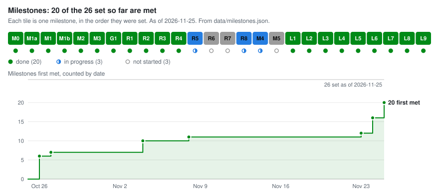

# Milestones

[&larr; back to the README](../README.md)

Each milestone has a **pass condition**, and the date is when that condition was first
met. The pass conditions of the `M` series, M5 aside, were set in the project's plan
before the work on them started; those of G1, the `R` and `L` series and M5 are worded
here from the project's record, some of them after the work. That difference matters: a pass
condition chosen afterwards tends to describe whatever happened, and this list is meant
to be checkable by someone who was not there.

A milestone being *done* means its pass condition was met at least once, on at least one
configuration. It does not mean the thing stayed working as later pieces changed around
it, and in a few cases it did not &mdash; where a later configuration lost something an
earlier milestone had, the note says so. Dates are US Pacific time.

The identifiers are in four series, because the goal was re-cut twice as the work
showed what was actually hard: `M` for the original route, `G` for graphics, `R` for
the re-cut goal of a root built only from macOS 27's own system volume, and `L` for the
steps from the login window to the desktop on that root. The series are
kept as they were rather than renumbered, so that earlier write-ups still refer to the
same things.

<!-- generated:chart-milestones:start -->
<picture>
  <source media="(prefers-color-scheme: dark)" srcset="charts/milestones-dark.svg">
  
</picture>
<!-- generated:chart-milestones:end -->

<!-- generated:milestones-table:start -->
Milestones, in the order they were set. Dates are when the pass condition was first met, US Pacific time.

|  | Milestone | Pass condition | State | First met | Evidence | Notes |
|---|---|---|---|---|---|---|
| M0 | Harness control: macOS 26 x86 recovery boots under QEMU, KVM and OpenCore | Verbose kernel log on serial, root mounted, launchd running | done | 2026-10-26 | measured | &mdash; |
| M1a | Build a kernel collection around 27.0.1's x86_64 kernel | A collection holding 27's kernel and the requested kexts | done | 2026-10-26 | measured | &mdash; |
| M1 | Boot 27.0.1's x86_64 kernel | 27's kernel banner on serial, then root mount | done | 2026-10-26 | measured | Needed seven early-boot patches. |
| M1b | Map the commpage into user processes | launchd survives its first commpage read | done | 2026-10-26 | measured | &mdash; |
| M2 | 27's x86_64 frameworks under macOS 26's boot daemons | Multi-user boot and an ssh root shell | done | 2026-10-26 | measured | &mdash; |
| M3 | 27's own userland: 27's x86_64 dyld, shared cache and programs | A root shell, and sw_vers reads 27 | done | 2026-10-27 | measured | The cache had to be re-signed at 4 KiB hash pages. |
| G1 | A window on screen (hybrid image) | Recovery window, Disk Utility and the installer drawn and taking input | done | 2026-10-26 | measured | Software compositor; small on-disk edits since 2026-11-04. |
| R1 | A root built only from 27.0.1's own system volume | Boots with a Data volume to launchd's daemon phase | done | 2026-11-04 | measured | &mdash; |
| R2 | 27's own Sandbox kext, recompiled to x86_64, enforcing | Deny probes give native 27.0.1's results | done | 2026-11-04 | measured | &mdash; |
| R3 | A kernel built from Apple's published source boots 27.0.1 | loginwindow and ssh, no kernel patch | done | 2026-11-04 | measured | Self-built; not Apple's kernel. Met on the hybrid image (macOS 26's recovery volume with 27's files placed over it); the 27-only root had no graphical session then (it has since drawn a login window and more: milestones L1 to L9). |
| R4 | 27's own launchd as pid 1 and xpcproxy, recompiled | Boots to a running payload; the kernel's hash of pid 1 names the lift | done | 2026-11-08 | measured | Since 2026-11-24 the project's default test bases, each one standalone disk image, carry both (2 test boots each). |
| R5 | 27's own amfid, logd, logd_helper and sandboxd in place of macOS 26's | Each stays up and does its job | in progress | &mdash; | measured | logd and logd_helper replaced (3 boots, running; read-back measured on other configurations); amfid stays up (4 boots of the furthest configuration; validation partly tested). On the display test overlays used for login boots, Apple's 27 amfid was put back, named for a translator build carrying patch S, and sandboxd was named for a newer translator build: since 2026-11-25 each has run as one process all boot with no crash report (3 login boots), where both crashed there before (docs/gaps.md, B11 and B17). Whether each does its whole job is not shown, and on the default test base adopted on 2026-11-25 amfid is still macOS 26's. |
| R6 | Fold the furthest configuration into one disk image | The image boots with its placed files verified | not started | &mdash; | not measured | &mdash; |
| R7 | launchd's own sshd reachable from the host | Host logins to launchd's sshd job | not started | &mdash; | not measured | &mdash; |
| R8 | No macOS 26 piece left in the boot | logd, logd_helper, the nine kexts, kmutil and the APFS EFI driver all replaced | in progress | &mdash; | measured | logd and logd_helper replaced (3 boots); the nine kexts, kmutil and the APFS EFI driver remain. So does macOS 26's x86 boot.efi, which the condition leaves out: 27.0.1 ships no x86 boot loader. The default test base adopted on 2026-11-25 also still carries macOS 26's amfid; the display test overlays used for login boots have had Apple's 27 amfid back since 2026-11-25 (3 boots). |
| M4 | A desktop on 27's own programs | loginwindow, then Finder, with no macOS 26 program in the session | in progress | &mdash; | measured | The pass condition is not met: there is no usable desktop yet, and that no macOS 26 program runs in the user session has not been checked (the system's amfid, still macOS 26's on the default test base, is R8's). On test overlays of the 27-only root, 27's loginwindow under translation draws the login window, a typed login is authorized, the user session starts and the first-login User Account Updater completes (milestones L1 to L4). With a per-user marker, placed by the test, that skips the first-login Setup Assistant, the Dock, Finder, SystemUIServer and Control Center start (L5), a menu bar and a wallpaper are drawn (L6) and clicks reach controls (L7); with a translator fix (patch AB) WindowManager stays up, a Finder window opens (L8) and TextEdit takes typed text (L9). Drawing is still slow or incomplete (docs/gaps.md, B22). |
| M5 | Graphics acceleration | A Metal device in the guest | not started | &mdash; | not measured | &mdash; |
| L1 | 27's login window on the 27-only root | The login window drawn on screen on a test overlay of the 27-only root | done | 2026-11-23 | measured | Drawn in 2 of 2 boots of one set-up and 1 of 2 of another when nothing held the display awake: whether it appears looks like a race with the guest's display going to sleep (inferred from one boot's timing, in which SecurityAgent logged that it was showing its window one second before the screens slept). It was also drawn in each of the 19 later scored boots in which a login was typed. |
| L2 | A typed login authorized | A name and password typed at the login window, and the console login authorized | done | 2026-11-24 | measured | In the first 2 boots no session followed; authorized again in each of the 17 later scored login boots. |
| L3 | The user session starts | Processes of the logged-in user run after the login | done | 2026-11-24 | measured | Needed a translator fix for mapping short shared-memory objects (docs/translator-patches.md, Q2). 17 boots. |
| L4 | The first-login User Account Updater completes | loginwindow reports that User Account Updater exited with success after the first login | done | 2026-11-24 | measured | Needed xpcproxy relinked with the newer link tools, so that accountsd could start (docs/boot-programs.md). 14 boots. Its Screen Time plug-in logged a failed call along the way in each. |
| L5 | The Dock, Finder, SystemUIServer and Control Center start after the first login | All four running after the first login and still running, once each, at the last reading of the boot | done | 2026-11-24 | measured | With a per-user marker, placed by the test, that skips the first-login Setup Assistant; in the 2 boots in which Setup Assistant ran, the Dock, Finder and SystemUIServer never started (Control Center did). 12 boots. The Dock was drawn in 11 of 12, first seen between about 10 and 50 minutes after the login. In the first two login boots on the default test base adopted on 2026-11-25, frames read up to 35 minutes showed no Dock; later frames show it drawn after 35 minutes, by about 50. |
| L6 | A menu bar and a wallpaper drawn after the login | Both on screen in a frame taken after the first login | done | 2026-11-25 | measured | With the per-user marker that skips Setup Assistant (L5). First in the first completed login boot with the translator fix for app-sandboxed programs (docs/translator-patches.md, AA), in which WindowManager crashed and was restarted all through it (docs/gaps.md, B25); drawn again in each of the 8 later login boots, in which WindowManager stayed up (patch AB). 9 boots. |
| L7 | A click reaches a control | A pointer click on a menu-bar item opens its menu | done | 2026-11-25 | measured | With the per-user marker that skips Setup Assistant (L5). The first was one click, on the Apple menu, which then showed its whole menu in the later frames (1 boot). In later boots clicks opened the Apple menu again (2 boots), a Finder window from the Dock's Finder icon (6 boots), a folder in Finder (7 boots), About This Mac and Control Center (2 boots). An earlier click, on a display test overlay, changed nothing on screen. |
| L8 | A Finder window drawn after the login | A Finder window on screen after the first login | done | 2026-11-25 | measured | With the per-user marker that skips Setup Assistant (L5) and the translator fix that keeps WindowManager up (docs/translator-patches.md, AB). 8 boots: opened by a click on the Dock's Finder icon in 6, and from the keyboard in 2 whose Dock was not drawn yet. Its first view, Recents, showed no items; the Applications folder listed its items by name, most icons drawn as placeholders for minutes (7 boots). |
| L9 | An app opens a window and takes typed text | An app started after the login opens a document window, and text typed into it appears there | done | 2026-11-25 | measured | With the per-user marker that skips Setup Assistant (L5). TextEdit, translated, opened from the Applications folder with the keyboard: its window appeared within 19 s in one boot and between about 19 and 63 s in the six others, and a word typed into it appeared (7 boots). One app and one word each; whether it does more has not been tested. |

Generated from `data/milestones.json` by `scripts/render.py`. Data and generated tables: [CC0-1.0](../LICENSE-CC0) (public domain).
<!-- generated:milestones-table:end -->

## What the remaining ones need

The milestones still open are not all of the same size:

- **R5** is not finished engineering. `logd`, `logd_helper` and `amfid` run, and since
  2026-11-25 `sandboxd` stays up when `launchd` starts it on the display test overlays used
  for login boots, named for a newer translator build (3 login boots; [gaps.md](gaps.md),
  B17, closed). There Apple's 27 `amfid` is back in place of macOS 26's and stays up too
  (3 login boots); on the default test base `amfid` is still macOS 26's and crashes
  ([gaps.md](gaps.md), B11). What is left is showing that each does its job.
- **R6** is folding work: the pieces exist and have been seen running, and what is left
  is getting them into one disk image at the same time.
- **R7** needs a host login to `launchd`'s own `sshd` job, in place of the debug
  `sshd` the test payload starts. **R8** needs a replacement for each piece still
  borrowed from macOS 26: the boot loader, nine kernel extensions, the collection
  builder and the boot loader's APFS driver; in some boot set-ups macOS 26's `vmxnet3`
  network driver; and, on the default test base, `amfid`
  ([gaps.md](gaps.md), B11).
- **M4** (a desktop) needs the arm64e-only session programs to run, translated or
  recompiled. So far, on test overlays of the 27-only root, 27's WindowServer and
  `loginwindow` under translation draw the login window, a typed login is authorized, the
  user session starts and the first-login User Account Updater finishes (L1 to L4). With
  Setup Assistant skipped by a per-user marker the test places, the Dock, Finder,
  SystemUIServer and Control Center start, a menu bar and a wallpaper are drawn and clicks
  reach controls (L5 to L7); with a translator fix (AB) WindowManager stays up, a Finder
  window opens and TextEdit takes typed text (L8, L9). What is missing is a usable desktop:
  drawing is slow or incomplete ([gaps.md](gaps.md), B22), and that no macOS 26 program
  runs in the user session has not been checked. A recompiled `loginwindow`
  launches and exits in one overlay boot (see [components.md](components.md#graphics) and
  [boot-programs.md](boot-programs.md)).
- **M5** (graphics acceleration) needs a Metal device, and there is no route to one yet.
  It is the furthest off, and nothing below it depends on it.
