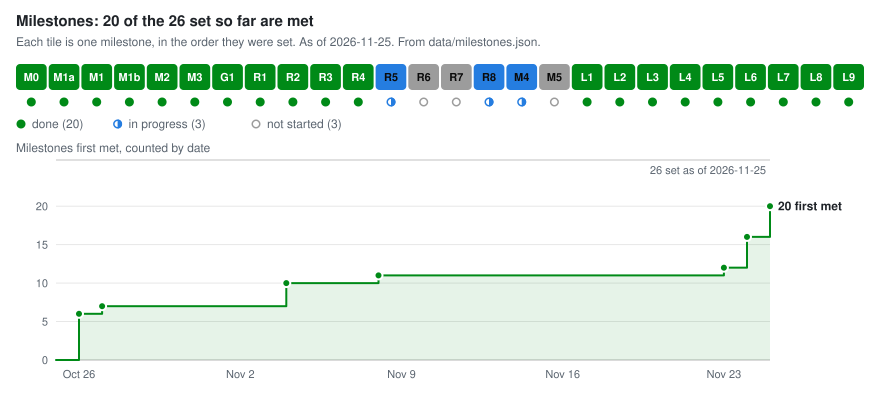
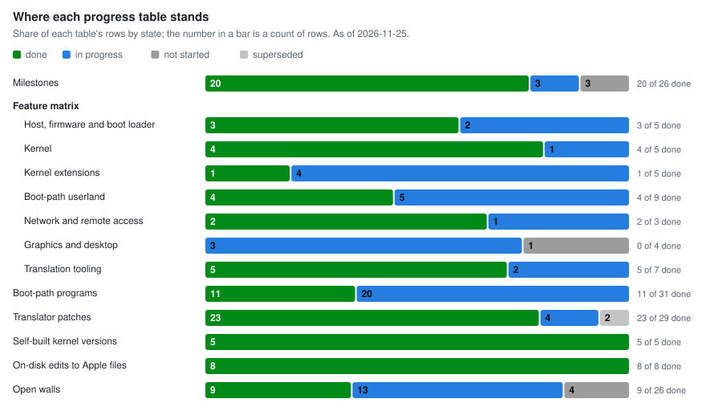
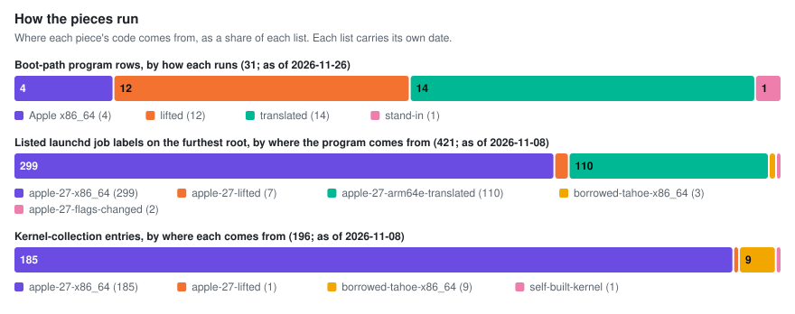

# Progress

[&larr; back to the README](../README.md)

The current figures of this record. This page, the other pages under `docs/` and the
charts take each routine update; the README changes only at a major milestone
([docs/maintaining.md](maintaining.md)). How to read the state and evidence words:
[docs/reading-guide.md](reading-guide.md).

<!-- generated:chart-milestones:start -->
<picture>
  <source media="(prefers-color-scheme: dark)" srcset="charts/milestones-dark.svg">
  
</picture>
<!-- generated:chart-milestones:end -->

## Where it stands

As of **2026-11-26**. The work runs in two stages ([docs/roadmap.md](roadmap.md)):
first something that works, built on whatever works today, including x86 code of Apple's
that the project means to stop depending on later; then the longer tail of replacing it.
The first stage's steps so far, all on test overlays of the 27-only root:

| Step | First reached | Boots |
|---|---|---|
| macOS 27's login window on screen | 2026-11-23 | Drawn in 2 of 2 boots of one set-up and 1 of 2 of another when nothing kept the display awake; whether it appears looks like a race with the guest's display going to sleep (inferred from one boot's timing, in which SecurityAgent logged that it was showing its window one second before the screens slept). Drawn in each of the 19 later scored boots in which a login was typed |
| A name and password typed at that window are authorized | 2026-11-24 | 19; in the first two, no session followed |
| The user session starts | 2026-11-24 | 17, all with a translator fix for mapping short shared-memory objects ([Q2](translator-patches.md)) |
| The first-login User Account Updater completes | 2026-11-24 | 14, all after `xpcproxy` was relinked so that `accountsd` could start |
| The Dock, Finder, SystemUIServer and Control Center start and stay up | 2026-11-24 | 12, each with a per-user marker, placed by the test, that skips the first-login Setup Assistant |
| The Dock is drawn | 2026-11-24 | 11 of 12 boots, first seen between about 10 and 50 minutes after the login |
| A menu bar and a wallpaper are drawn | 2026-11-25 | 9 |
| A click opens the Apple menu | 2026-11-25 | 3 |
| WindowManager stays up after the login | 2026-11-25 | 8, all with a translator fix ([AB](translator-patches.md)) |
| A Finder window opens | 2026-11-25 | 8: from the Dock in 6, from the keyboard in 2 |
| An app, TextEdit, opens a window and takes typed text | 2026-11-25 | 7 |
| About This Mac and Control Center open | 2026-11-25 | 2, partly drawn; About This Mac shows the model and chip as Unknown |
| `sandboxd` and 27's own `amfid` stay up through a login boot | 2026-11-25 | 3, on the display test overlays |
| A translated program's arm64-only helper is started as itself | 2026-11-26 | 2, with a translator change ([AC](translator-patches.md)) |

What changed since the last snapshot (every boot here is one boot of its set-up, n = 1):

- **`sandboxd` and 27's `amfid` stay up.** On the display test overlays, `sandboxd` was named
  for a newer translator build, and Apple's 27 `amfid` was put back in place of macOS 26's,
  named for a build carrying patch S; neither needed new code. In the login boot of
  2026-11-25 and both of 2026-11-26, each ran as one process all boot and wrote no crash
  report, where before they wrote 17, and 7 to 9, a boot; no kernel line of a code-directory
  check found `amfid`'s server gone. Which build ran `amfid` was not read directly, and
  whether either answers every request correctly is not shown ([docs/gaps.md](gaps.md),
  B17, now closed, and B11).
- **A translated program's arm64-only helper is started as itself.** With a translator change
  that hands such starts to the kernel ([AC](translator-patches.md)), a translated disk-image
  tool attached a RAM disk: the kernel started its arm64-only helper as itself, with its own
  signature and entitlement, and no daemon refused it; in the same boot the same tool on a
  build without AC was refused for the missing entitlement, as before (2 boots, 2026-11-26;
  B26, now closed). The child's identity was read only for that helper's family; in the
  second boot a parent with AC also handed another program's start to the kernel and the
  command worked (how that child then ran was not read). Programs on builds without AC still
  start their children under the translator's identity.
- **The translator from the fork's public branch was booted.** Built from the branch's tip
  ([UPSTREAMS.md](../UPSTREAMS.md)), it replaced the local builds for every program they had
  been named for but the disk-image control, and every row for the programs it ran held:
  the disk-image pair, WindowManager up, the five app-sandboxed agents, TextEdit, `sandboxd`
  and the disk-arbitration daemon one process each, and, of the six system calls the test
  tracks, none refused for any program but a test probe (1 boot, 2026-11-26). Not shown yet:
  which build ran `sandboxd` (inferred from its setting); the Dock, which does not run on the
  changed build, came late, after about 22 minutes and a click (inferred to vary from boot to
  boot, not ruled out); and two programs that do not run on the changed build crashed where
  the boot before had no such crash, one with an illegal instruction.
- **On the default test base, the load and the late Dock are read.** In its first two login
  boots the Dock was drawn only after 35 minutes, by about 50, while the guest's load stayed
  5 to 10 times higher; this page said "no Dock" before, from frames read only up to 35
  minutes.
  The load is read: three network daemons exit and are restarted about every 10 seconds all
  boot (the guest has no Wi-Fi hardware); on that base's default translator build each run
  lasts seconds, at many of airportd's exits the translator starts background work to rebuild
  its saved translations (read in its source; that the extra processes seen are that work is
  inferred), and many runs crossed their memory limit and got a full crash snapshot (inferred
  to be the runs that loaded a saved translation). With the translator's saved-translation cache turned off for those three
  daemons, an existing translator setting used as a diagnostic, the load while the guest was
  used was 5 to 17 (before, 57 to 149), the Dock was drawn within 15 minutes, a Finder window
  opened from it and TextEdit took a typed word (1 boot, 2026-11-26). The fix meant is in the
  translator: a change that builds each program image's saved translation at most once for each
  translation format (a failed build is tried again later), with one builder at a time for
  each store, is built and not booted. Naming two other daemons for a newer build, the boot before
  (1 boot), removed one daemon's refused memory call, while the other still aborted (19 crash
  reports), the load stayed high and the Dock was still late.
- **A daemon there aborts for want of a model identity.** The log of `apsd`, read for the
  first time, shows each of its 20 runs ending on an uncaught exception: the model identity
  it asks macOS for comes back empty, and it puts that in a dictionary unchecked (inferred).
  Its abort text was read on one translator build, and its crash reports had the same shape
  on another, so this is inferred not to be the translator. Read in Apple's binaries and the
  guest's firmware settings (not yet in a running guest): the guest's firmware creates the
  entry macOS 27 reads this answer from, but puts no values in it; About This Mac's Unknown
  model and chip are inferred to share the cause.
  Which identity the guest should present is pending the owner.

Separately, the default test base was replaced on 2026-11-25. The new one is the previous
standalone disk image with a later translator build as its default translator (adding the
one root-owned store of slid shared-cache data, [R2](translator-patches.md), and fix Z)
and an empty shared store; `amfid` is still macOS 26's x86-64 build (named by its crash reports
in one login boot on it), recompiled programs are not translated, and the registry-stall fix stays in its kernel collection. In its 2 test boots
every required row passed (31 of 31 and 29 of 29), and no per-home copies of the slid data
were found at any sample. Against a matched control boot of the previous base, free space
fell by 1.54 GiB over about 20 minutes from early in the boot, against 5.23 GiB (1 boot
each). It is not yet where logins are tested; its three login boots are described above.

Blocked now:

- **Drawing after the login is slow or incomplete.** The Dock was first seen between about
  10 and 50 minutes after the login, and in 1 of 12 boots not at all; most icons stay
  placeholders for minutes; Control Center opened with unnamed modules and no slider
  tracks, and About This Mac showed the model and chip as Unknown (2 boots); old screen
  contents show through in places. On the default test base the load is read as what held
  the Dock back (above); on the display test overlays the causes are not read
  ([docs/gaps.md](gaps.md), B22).
- **The default test base is not yet sound for login boots**: its load waits on the
  translator change above being booted, and its `amfid` is still macOS 26's.

Still open:

- **The translator's shared-cache data fills the disk.** The same files were copied into
  every store directory the translator made, one per home directory or sandbox container
  that used it: 16 stores held about 9 GiB of cache files in one boot, mostly duplicated
  slid data, and the disk ran out. With the fix (one root-owned store) named for about 120
  to 130 programs of the login session, the lowest free space in the latest three login boots
  on the display test overlays was between 5.04 and 5.52 GiB, with three per-home stores
  left in each. In the three login boots on the default test base, which uses the fix for
  nearly every translated program, it was 6.24, 5.23 and 6.36 GiB with one per-home store
  left in each, but the translator's other cached files were still kept per home. Disk use
  through a login with every program on the fix is not shown yet (B23).
- **Which model identity the guest presents**: pending the owner (above).

What does not work yet, plainly: there is no usable desktop (drawing is slow or incomplete,
the Dock may take up to about 50 minutes to appear or, once in 12 boots, not at all, and one app has been opened and one word
typed into it) and no GPU acceleration; for most programs seen running, whether they do
their job has not been tested; pieces of macOS 26 are still in the boot; and every way
programs run here leans on Apple's x86-64 libraries, which a release after macOS 27 may
drop. How close the first stage, and so the first guide, is, part by part:
[docs/roadmap.md](roadmap.md#stage-1-working-first). The full list is
[What is not shown yet](#what-is-not-shown-yet), below.

The projects this work builds on, their measured activity, and this project's open items
with them: [UPSTREAMS.md](../UPSTREAMS.md).

<!-- generated:chart-status-overview:start -->
<picture>
  <source media="(prefers-color-scheme: dark)" srcset="charts/status-overview-dark.svg">
  
</picture>
<!-- generated:chart-status-overview:end -->

## Status at a glance

<!-- generated:progress-status:start -->
As of **2026-11-26**. Guest: **macOS 27.0.1 (build 26A434)**. Host: an ordinary x86_64 PC running Linux, QEMU and KVM.

| What | Rows | done | in progress | not started | Other | Detail |
|---|---|---|---|---|---|---|
| Milestones | 26 | 20 | 3 | 3 | &mdash; | [docs/milestones.md](milestones.md) |
| Feature matrix: Host, firmware and boot loader | 5 | 3 | 2 | 0 | &mdash; | [docs/components.md](components.md#host) |
| Feature matrix: Kernel | 5 | 4 | 1 | 0 | &mdash; | [docs/components.md](components.md#kernel) |
| Feature matrix: Kernel extensions | 5 | 1 | 4 | 0 | &mdash; | [docs/components.md](components.md#kexts) |
| Feature matrix: Boot-path userland | 9 | 4 | 5 | 0 | &mdash; | [docs/components.md](components.md#userland) |
| Feature matrix: Network and remote access | 3 | 2 | 1 | 0 | &mdash; | [docs/components.md](components.md#network) |
| Feature matrix: Graphics and desktop | 4 | 0 | 3 | 1 | &mdash; | [docs/components.md](components.md#graphics) |
| Feature matrix: Translation tooling | 7 | 5 | 2 | 0 | &mdash; | [docs/components.md](components.md#tools) |
| Boot-path programs | 31 | 11 | 20 | 0 | &mdash; | [docs/boot-programs.md](boot-programs.md) |
| Translator patches | 30 | 23 | 5 | 0 | 2 superseded | [docs/translator-patches.md](translator-patches.md) |
| Self-built kernel versions | 5 | 5 | 0 | 0 | &mdash; | [docs/translator-patches.md](translator-patches.md#self-built-kernel-versions) |
| On-disk edits to Apple files | 8 | 8 | 0 | 0 | &mdash; | [docs/translator-patches.md](translator-patches.md#on-disk-edits-to-apple-files) |
| Open walls | 26 | 11 | 11 | 4 | &mdash; | [docs/gaps.md](gaps.md) |

Generated from `data/status.json`, `data/milestones.json`, `data/components.json`, `data/boot-programs.json`, `data/translator.json`, `data/gaps.json` by `scripts/render.py`. Data and generated tables: [CC0-1.0](../LICENSE-CC0) (public domain).
<!-- generated:progress-status:end -->

Inventories, which are lists rather than progress trackers:

<!-- generated:progress-inventories:start -->
| Inventory | Rows | Breakdown | Detail |
|---|---|---|---|
| Kernel-collection entries | 196 | 185 apple-27-x86_64, 9 borrowed-tahoe-x86_64, 1 apple-27-lifted, 1 self-built-kernel | [docs/kexts.md](kexts.md) |
| launchd job labels, by origin | 421 | 299 apple-27-x86_64, 110 apple-27-arm64e-translated, 7 apple-27-lifted, 3 borrowed-tahoe-x86_64, 2 apple-27-flags-changed | [docs/launchd-labels.md](launchd-labels.md) |
| launchd job labels, by what happened in one boot | 421 | 103 ran, 15 ran but exited nonzero, 303 not started | [docs/launchd-labels.md](launchd-labels.md) |
| Accepted-risk records (a selection from a register of 83), by who decided | 52 | 6 accepted by the owner, 1 bug-for-bug compatible with Apple, 4 direction set by the owner, 15 project default, 15 pending the owner, 8 fixed, 3 retired | [docs/gaps.md](gaps.md#accepted-risk-records) |

Generated from `data/kexts.json`, `data/launchd-labels.json`, `data/gaps.json` by `scripts/render.py`. Data and generated tables: [CC0-1.0](../LICENSE-CC0) (public domain).
<!-- generated:progress-inventories:end -->

<!-- generated:chart-how-pieces-run:start -->
<picture>
  <source media="(prefers-color-scheme: dark)" srcset="charts/how-pieces-run-dark.svg">
  
</picture>
<!-- generated:chart-how-pieces-run:end -->

## What has been measured

The claims the rest of the repository rests on. Each says how it is known and how many
times.

<!-- generated:progress-headline:start -->
- A root built only from macOS 27.0.1's own system volume, with a real Data volume, boots under QEMU and KVM and reaches launchd's daemon phase. *(measured, n = many boots)*
- On that root, macOS 27's own launchd (pid 1) and xpcproxy run as x86_64 programs recompiled from Apple's arm64e builds by the project's lifter. *(measured, n = 3 boots for launchd and 2 for xpcproxy, one configuration each)*
- macOS 27's own arm64e Sandbox kext, its 958 reachable functions (of 967) recompiled to x86_64, loads and enforces: file read, write and exec denies, a network deny and default-deny give the same results as native 27.0.1. *(measured, n = 2 boots on Apple's kernel image; on the self-built kernel, 2 boots agreeing on every probe row plus 1 on a later version)*
- Root logins over ssh return sw_vers 27.0.1 on x86_64. *(measured, n = 3 of 3 logins in 8 of 9 boots of the furthest configuration with a 180 s login timeout, 1 of 3 in one; 0 with a 60 s timeout, explained in docs/components.md)*
- On test overlays of the 27-only root, 27's own login window is drawn, a name and password typed at it are authorized, the user session starts, and the first-login User Account Updater completes. With a per-user marker that skips the first-login Setup Assistant, the Dock, Finder, SystemUIServer and Control Center then start and stay up, and a menu bar and a wallpaper are drawn. With a translator fix (patch AB) WindowManager stays up, a Finder window opens, and TextEdit opens a window and takes typed text; clicks opened the Apple menu, About This Mac and Control Center. No usable desktop follows yet: drawing is slow or incomplete. *(measured, n = window and authorized login: 19 boots; session: 17; User Account Updater: 14; Dock, Finder, SystemUIServer and Control Center: 12; Dock drawn: 11 of 12; menu bar and wallpaper: 9; WindowManager staying up, and a Finder window: 8; TextEdit: 7; the Apple menu: 3; About This Mac and Control Center: 2)*
- The kernel the furthest configuration uses is built by the project from Apple's published xnu source (macOS 26.5's), plus the interfaces 27 needs, re-derived from 27's own x86_64 machine code. It is not Apple's kernel and reports version 25.5.0. *(measured, n = build reproduced for each version)*

Generated from `data/status.json` by `scripts/render.py`. Data and generated tables: [CC0-1.0](../LICENSE-CC0) (public domain).
<!-- generated:progress-headline:end -->

## What is not shown yet

This list is the point of the page. It is kept at least as current as the one above,
because a progress record that lists only the wins is not a record of anything.

<!-- generated:progress-not-shown:start -->
- No usable desktop on the 27-only root yet. On its test overlays, after the first login, the Dock, Finder, SystemUIServer and Control Center start (12 boots), a menu bar and a wallpaper are drawn (9 boots), WindowManager stays up with patch AB (8 boots), a Finder window opens (8 boots) and TextEdit opens a window and takes typed text (7 boots). But drawing is slow or incomplete: the Dock was first seen between about 10 and 50 minutes after the login, and was not drawn at all in 1 of 12 boots; most app icons in a Finder window stay placeholders for minutes; Control Center opened with unnamed modules and no slider tracks, and About This Mac shows the model and chip as Unknown (2 boots); old screen contents show through in places. On the display test overlays the causes are not read (docs/gaps.md, B22). On the default test base adopted on 2026-11-25 the guest's load while it was used stayed 5 to 10 times higher in its first two login boots, and its cause is read: the translator's work for three network daemons that keep restarting. With a diagnostic setting that removed it, the Dock was drawn within 15 minutes (1 boot); the fix meant, a translator change, is built and not booted, and the base is not yet where logins are tested. Setup Assistant is skipped on these overlays by a per-user marker the test places; in the 2 boots in which it ran, no pane of it appeared, and why is not read. The 27-only root's login window is drawn; the recovery window, Disk Utility and the installer are drawn only on a hybrid image (macOS 26's recovery volume with 27's files placed over it), with a software compositor.
- The kernel is self-built from Apple's macOS 26.5 source, not Apple's 27.0.1 kernel. Apple's own 27.0.1 x86_64 kernel also boots, but only with load-time patches. In one test the self-built kernel allowed a call that Apple's arm64 kernel refused on an Apple silicon Mac running macOS 27.0.1, under different security settings, and that Apple's published source allows only with a kernel-debugger setting the guest leaves off (docs/components.md, the kernel row).
- No GPU acceleration: there is no Metal device.
- Pieces of macOS 26 (Tahoe) are still in the boot: the x86 boot loader (boot.efi, which 27.0.1 does not ship), nine kexts, the tool that builds the kernel collection, and the APFS driver the boot loader uses; some boot set-ups also add macOS 26's vmxnet3 network driver; and the default test base adopted on 2026-11-25 still carries macOS 26's amfid (below), which the display test overlays used for login boots replaced with Apple's 27 build on 2026-11-25. 27's own logd and logd_helper replaced macOS 26's in three boots.
- The ssh logins are to a debug sshd the test payload starts, not to launchd's own sshd job, and that sshd is 27's arm64e program under translation.
- macOS 27's own amfid runs under translation and stays up (4 boots of the furthest configuration, and, with no crash report, 3 login boots on the display test overlays since 2026-11-25). In one boot it refused an ad hoc signed program carrying a restricted entitlement, as Apple's does; whether it answers every signature check correctly has not been tested, and an edited-signature test did not discriminate. On the default test base adopted on 2026-11-25 the amfid in place is still macOS 26's x86_64 build, the one that crashed on the overlays after calling a method macOS 27's code-signing framework has renamed; its three login boots wrote 6, 6 and 7 amfid crash reports (those of the first name that build) (docs/gaps.md, B11).
- sandboxd is shown staying up when launchd starts it only on the display test overlays used for login boots, since 2026-11-25: one process all boot, no crash report (3 login boots), named for a newer translator build. Before, on an older build without patch U, it was stopped at once there when its own sandbox profile refused run-time code (17 crash reports in each of 2 boots read). Whether all its answers are right has not been read, and which build runs it on the default test base was not read (docs/gaps.md, B17).
- The 240-second registry stall early in boot is explained (docs/gaps.md, B18), and the project's default test bases since 2026-11-24 carry one of its two fixes; most rows of this record predate them. Keyboard input reaches the login window, and after the login it reached TextEdit (7 boots). After a login, clicks have opened the Apple menu (3 boots), a Finder window from the Dock (6 boots), a folder in Finder (7 boots), About This Mac and Control Center (2 boots); an earlier click, on a display test overlay, changed nothing on screen.
- The translator copies the same slid shared-cache data into a store per home directory or sandbox container that uses it: in one boot 16 stores held about 9 GiB of cache files, mostly duplicated slid data, and the root's 51.5 GB container ran out of space. A fix keeps one root-owned shared copy (patch R2). In the login boots on the display test overlays, with it named for about 120 to 130 programs of the login session, the lowest free space in the latest five was between 4.55 and 5.84 GiB, and three per-home stores remained in each. On the default test base adopted on 2026-11-25, which uses it for nearly every translated program, no per-home copies were found in its 2 test boots, which take no login; in its three login boots the lowest free space was 6.24, 5.23 and 6.36 GiB and one per-home store of slid data remained in each (its writer not read), while the translator's other cached files were still kept per home. So disk use through a login with every program on the fix is still not shown (docs/gaps.md, B23).
- Every way programs run here needs Apple's x86_64 libraries, which macOS 27 ships for Rosetta: Apple's own x86_64 programs, the recompiled ones, and the translator itself. Apple has said general-purpose Rosetta stays through macOS 27 and only a subset after it. What that means for the plan: docs/roadmap.md.
- For most programs only 'running' was measured, not that they do their job.
- Many results are one boot per configuration, often on a heavily loaded lab host. Behaviour past a 1-minute load average of about 100 has not been tested systematically; the first-run timings in docs/gaps.md (B15) were taken at a load of 130 to 198.
- Lifted programs that must be platform binaries are signed with a lab key that Apple's developer trusted-key mechanism is told to trust. That is a lab arrangement, not something a user install could rely on.

Generated from `data/status.json` by `scripts/render.py`. Data and generated tables: [CC0-1.0](../LICENSE-CC0) (public domain).
<!-- generated:progress-not-shown:end -->

## Detail

<!-- generated:progress-details:start -->

<strong>Milestones</strong> &mdash; 20 done, 3 in progress, 3 not started

|  | Milestone | State | First met |
|---|---|---|---|
| M0 | Harness control: macOS 26 x86 recovery boots under QEMU, KVM and OpenCore | done | 2026-10-26 |
| M1a | Build a kernel collection around 27.0.1's x86_64 kernel | done | 2026-10-26 |
| M1 | Boot 27.0.1's x86_64 kernel | done | 2026-10-26 |
| M1b | Map the commpage into user processes | done | 2026-10-26 |
| M2 | 27's x86_64 frameworks under macOS 26's boot daemons | done | 2026-10-26 |
| M3 | 27's own userland: 27's x86_64 dyld, shared cache and programs | done | 2026-10-27 |
| G1 | A window on screen (hybrid image) | done | 2026-10-26 |
| R1 | A root built only from 27.0.1's own system volume | done | 2026-11-04 |
| R2 | 27's own Sandbox kext, recompiled to x86_64, enforcing | done | 2026-11-04 |
| R3 | A kernel built from Apple's published source boots 27.0.1 | done | 2026-11-04 |
| R4 | 27's own launchd as pid 1 and xpcproxy, recompiled | done | 2026-11-08 |
| R5 | 27's own amfid, logd, logd_helper and sandboxd in place of macOS 26's | in progress | &mdash; |
| R6 | Fold the furthest configuration into one disk image | not started | &mdash; |
| R7 | launchd's own sshd reachable from the host | not started | &mdash; |
| R8 | No macOS 26 piece left in the boot | in progress | &mdash; |
| M4 | A desktop on 27's own programs | in progress | &mdash; |
| M5 | Graphics acceleration | not started | &mdash; |
| L1 | 27's login window on the 27-only root | done | 2026-11-23 |
| L2 | A typed login authorized | done | 2026-11-24 |
| L3 | The user session starts | done | 2026-11-24 |
| L4 | The first-login User Account Updater completes | done | 2026-11-24 |
| L5 | The Dock, Finder, SystemUIServer and Control Center start after the first login | done | 2026-11-24 |
| L6 | A menu bar and a wallpaper drawn after the login | done | 2026-11-25 |
| L7 | A click reaches a control | done | 2026-11-25 |
| L8 | A Finder window drawn after the login | done | 2026-11-25 |
| L9 | An app opens a window and takes typed text | done | 2026-11-25 |

Pass conditions, evidence and notes: [docs/milestones.md](milestones.md).

<strong>Feature matrix, by area</strong> &mdash; 19 done, 18 in progress, 1 not started

| Area | Rows | done | in progress | not started |
|---|---|---|---|---|
| Host, firmware and boot loader | 5 | 3 | 2 | 0 |
| Kernel | 5 | 4 | 1 | 0 |
| Kernel extensions | 5 | 1 | 4 | 0 |
| Boot-path userland | 9 | 4 | 5 | 0 |
| Network and remote access | 3 | 2 | 1 | 0 |
| Graphics and desktop | 4 | 0 | 3 | 1 |
| Translation tooling | 7 | 5 | 2 | 0 |

Every row, with what runs there today: [docs/components.md](components.md).

<strong>Boot-path programs</strong> &mdash; 11 done, 20 in progress, 0 not started

| How it runs | Rows |
|---|---|
| Apple x86_64 | 4 |
| lifted | 12 |
| translated | 14 |
| stand-in | 1 |

Every program, with its note: [docs/boot-programs.md](boot-programs.md).

<strong>Translator patches</strong> &mdash; 23 done, 5 in progress, 0 not started, 2 superseded

The translator changes the project runs are kept on a public branch of its fork (queue/boot-tested-2026-11-24 on willmcginnis/maclator; UPSTREAMS.md). Each change that fits upstream is still offered there as a small, clean change framed around that project's own goals; patch J still needs splitting first. The upstream cut of patch G was merged on 2026-11-10 (de04499f, pull request #12). On 2026-11-23 patch K (pull request #16), four more changes (#17, #18, #19 and #22) and two questions as issues (#20 and #21) were posted; all are open at this snapshot. On 2026-11-24 a commit was added to #22 (the runtime's own sysctl names stay usable in a forked child), and the descriptions of #19 and #22 were revised; read again on 2026-11-25 and 2026-11-26, all were still open with no reply from upstream. The rest have not been posted. On 2026-11-24 and 2026-11-25 the fork's branch gained R2, Z, AA, AB and some smaller fixes to the translation cache, the event imitation and their tests, and on 2026-11-26 patch AC with five changes from its reviews. The translator built from the branch's tip after that was booted on 2026-11-26 on a display test overlay, in place of the local builds for every program they had been named for but the disk-image control, and every row for the programs it ran held (1 boot), while the Dock, which does not run on it, came late and two programs not on it newly crashed; local builds carrying R2, Z, AA and AB had been booted before.

Every patch, what it fixes and how it was tested: [docs/translator-patches.md](translator-patches.md).

<strong>Open walls</strong> &mdash; 11 done, 11 in progress, 4 not started

|  | Wall | State |
|---|---|---|
| B1 | Identity of a program under translation | done |
| B2 | No Data volume beside 27's system volume | done |
| B3 | Mounting the Preboot volume needs an arm64e-only program | in progress |
| B4 | No x86_64 Sandbox kext for 27 | done |
| B5 | fork safety under translation | in progress |
| B6 | pid 1 from 27's own launchd | in progress |
| B7 | Display-state mismatch and the backdrop abort (hybrid image) | done |
| B8 | No GPU | not started |
| B9 | Building the kernel collection with 27's own tools | in progress |
| B10 | 27's own logd | in progress |
| B11 | 27's own amfid | in progress |
| B12 | Daemons that run but do not yet serve | in progress |
| B13 | DEVELOPMENT build of the self-built kernel | not started |
| B14 | A circular wait at exec that could freeze the boot | done |
| B15 | The first translated run of a boot is slow | not started |
| B16 | File flags lost on the Data volume | done |
| B17 | 27's sandboxd did not stay up under launchd | done |
| B18 | The 240-second registry stall and the HID driver extension | in progress |
| B19 | A launchd-managed sshd on the furthest configuration | not started |
| B20 | Stopping a service panicked the guest | done |
| B21 | No login window on the display test overlays | done |
| B22 | No usable desktop after the first login | in progress |
| B23 | The translator's shared-cache data fills the disk | in progress |
| B24 | The session's app-sandboxed agents stop before their main function | in progress |
| B25 | WindowManager kept crashing after the login | done |
| B26 | An arm64-only program started by a translated program carries the translator's identity | done |

Notes, and the accepted-risk records beside them: [docs/gaps.md](gaps.md).

Generated from `data/milestones.json`, `data/components.json`, `data/boot-programs.json`, `data/translator.json`, `data/gaps.json` by `scripts/render.py`. Data and generated tables: [CC0-1.0](../LICENSE-CC0) (public domain).
<!-- generated:progress-details:end -->
